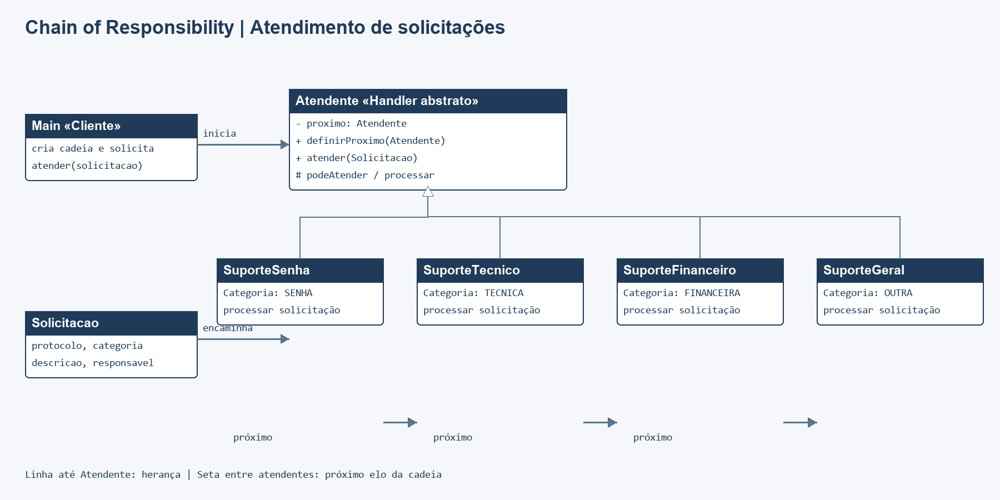

# Padrão Chain of Responsibility em Java

Aplicação de console que encaminha solicitações de atendimento por uma cadeia de responsáveis. Cada atendente trata as categorias que conhece ou passa a solicitação ao próximo. O cliente usa o primeiro elo e não precisa conhecer os atendentes seguintes.

## Executar

Requer JDK 8 ou superior, sem dependências externas. Na raiz do repositório:

```sh
mkdir out
javac -encoding UTF-8 -d out src/*.java tests/*.java
java -cp out Main
java -cp out ChainResponsibilityTest
```

Se `out` já existir, pule o `mkdir`. O programa de testes usa verificações explícitas: falhas lançam `AssertionError` e terminam com código de erro.

## Participantes

| Papel | Classe |
| --- | --- |
| Handler abstrato | `Atendente` |
| Handlers concretos | `SuporteSenha`, `SuporteTecnico`, `SuporteFinanceiro`, `SuporteGeral` |
| Solicitação | `Solicitacao` |
| Cliente / montagem da cadeia | `Main` |

A cadeia padrão é: suporte de acesso → suporte técnico → equipe financeira → atendimento geral. Cada atendente decide se pode processar uma solicitação. Se não puder, delega ao próximo. Se o fim da cadeia for alcançado, a solicitação permanece pendente e o método retorna `false`.

## Diagrama de classes



Fonte editável: [diagrama.mmd](docs/diagrama.mmd).

## Testes

`tests/ChainResponsibilityTest.java` cobre encaminhamento de cada categoria, passagem para o próximo handler, solicitação sem atendente compatível e independência entre solicitações.
